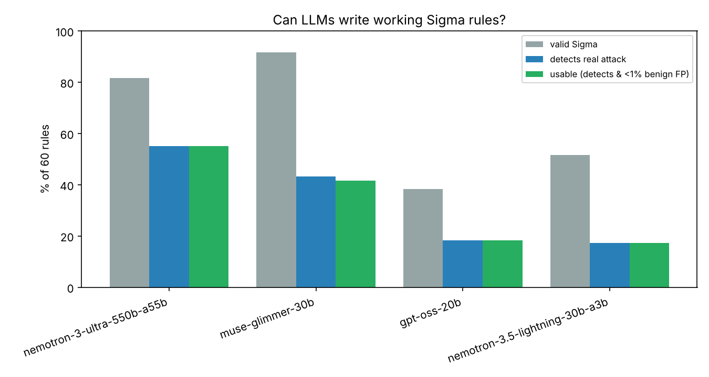

# sigma-llm-bench

**Can LLMs do detection engineering?** This benchmark gives models a detection idea in
plain English and asks for a Sigma rule. The rule is then tested against **real attack
telemetry** and **real benign Windows logs**, with the human-written SigmaHQ rule as
the reference.

## Key findings

Run in October 2026: 60 rules × 4 models = 238 generated rules (2 generations failed),
scored against real attack events and ~33k benign Windows events.



| Model | Rules | Valid Sigma | Detects real attack | **Usable** | Noisy (>1% benign) | ATT&CK technique match |
|---|---|---|---|---|---|---|
| SigmaHQ (human reference) | 60 | 100% | 100% | **100%** | 0% | — |
| nemotron-3-ultra-550b-a55b | 60 | 81.7% | 55.0% | **55.0%** | 0% | 66.1% |
| muse-glimmer-30b | 60 | 91.7% | 43.3% | **41.7%** | 1.7% | 44.6% |
| gpt-oss-20b | 60 | 38.3% | 18.3% | **18.3%** | 0% | 33.9% |
| nemotron-3.5-lightning-30b-a3b | 58 | 51.7% | 17.2% | **17.2%** | 0% | 9.3% |

*Usable = valid, fires on the real attack, and matches fewer than 1% of benign events.
ATT&CK match = shares at least one technique ID with the human rule; responses with
no parseable rule count as a miss. mistral-large-4 was excluded (6/60 answered on the
free API tier).*

**1. Even the best model writes a working rule only about half the time.** No model came
close to the human baseline. For the smaller models, more than 4 out of 5 rules would
silently fail in production.

**2. A third of all rules aren't valid Sigma, mostly because of invented syntax.**
81 of 238 rules (34%) would be rejected by real Sigma tooling. The most common cause
(44 rules) is a **modifier that does not exist** but looks plausible:

| Invented modifier | Count | Real Sigma |
|---|---|---|
| `\|regex` | 18 | `\|re` |
| `\|any` | 13 | default list behaviour (no modifier) |
| `\|not`, `\|notcontains`, `\|ne` | 4 | a `filter` selection plus `and not` in the condition |
| `\|in`, `\|equals`, `\|lowercase`, ... | 9 | — |

This is package hallucination applied to a DSL: the model writes what the syntax
*should* look like. Smaller models also wrote whole detections as one plain string
instead of a field map.

**3. LLM rules fail by being wrong, not noisy.** Only 1 of 157 valid rules was noisy,
and the median rule fired on **zero** benign events. Of the 77 valid rules that missed
their attack, **75 encoded the wrong detection logic**: the model guessed how the
attack looks, and the real attack looked different. The other 2 relied on fields that
don't exist in that log source. Two examples from manual review:

- *LSASS dump via comsvcs.dll*: the model required the process image to be
  `rundll32.exe`. In the real attack, rundll32 was launched **from inside a PowerShell
  command line**. The human rule anticipates this; the generated one never fires.
- *Software inventory recon via WMIC*: asked to detect `wmic product` enumeration, the
  model wrote a rule for WMIC queries about antivirus and firewall products. That is
  plausible-sounding but a different behaviour, so it never matches the real
  `wmic product where ...` command.

**4. Registry rules were easiest (44% usable across models), process creation and
PowerShell the hardest (about 30%).** Registry persistence locations are well
documented in public sources. Command-line tradecraft varies far more.

### Takeaways for detection engineering teams
- **Never ship an LLM-written rule without testing it against real attack telemetry.**
  A rule that is valid and quiet on benign data can still detect nothing. Low false
  positives are not evidence of a good rule.
- **Lint against the actual Sigma spec in CI** (e.g. `sigma check` from pySigma). That
  alone catches about a third of LLM rules.
- **Give the model telemetry, not just a description.** Most misses came from wrong
  assumptions about what the attack looks like in logs. Prompting with a sample event
  is the obvious next experiment.

## How it works

```
SigmaHQ rule ──► title + description only ──► LLM writes a Sigma rule
      │                                              │
      ▼                                              ▼
regression attack events ◄────── evaluate ──────► Nextron benign baseline
(SigmaHQ regression_data)       (sigbench/matcher.py)   (~33k unique events)
```

1. **Tasks:** 60 SigmaHQ rules that ship with *regression data* (real attack events
   recorded when the attack was executed), stratified across four Windows log sources:
   process creation (34), PowerShell script block (11), registry set (9) and file
   events (6). Fixed seed, see [`generate.py`](generate.py).
2. **Prompt:** the model sees only the rule's **title, description, log source and
   available field names**. It never sees the original rule or the attack event.
3. **Evaluation** uses a self-contained Sigma evaluator,
   [`sigbench/matcher.py`](sigbench/matcher.py), that is strict about the Sigma spec:
   - **valid:** parses as YAML, has a detection and condition, uses only real Sigma
     modifiers and scalar values
   - **detects:** fires on the real attack event(s) for that rule
   - **benign hits:** how many events it fires on in a de-duplicated benign corpus
     built from Nextron's
     [evtx-baseline](https://github.com/NextronSystems/evtx-baseline): clean Windows
     10/11 installs with normal activity, giving 3,243 process creations, 15,000
     registry sets, 15,000 file events and 111 script blocks
   - **usable:** valid, detects, and fires on fewer than 1% of benign events
   - **ATT&CK tags:** whether the rule's technique and tactic tags overlap the human
     rule's
4. **Miss analysis:** each valid rule that misses its attack is labelled either as using
   a field that does not exist in that log source, or as wrong detection logic. Examples
   were then reviewed by hand.

### Validating the evaluator

A benchmark is only as good as its scorer. Before scoring any model,
[`validate_matcher.py`](validate_matcher.py) runs **all 405 SigmaHQ rules that have
regression data** through the evaluator. **405/405 fire on their own attack events.**
Building that check found and fixed two real evaluator bugs (a trailing backslash
escaping a modifier-added wildcard, and missing JSON events) before any model was
scored.

## Limitations

- 60 rules, one generation each at temperature 0.2. Results show clear differences
  between models but not fine-grained rankings.
- The benign corpus is small for PowerShell (111 unique script blocks) and comes from
  lab machines. Real enterprise baselines are noisier, so the false-positive numbers
  here are a lower bound.
- "Detects" means firing on one recorded execution of the attack. A rule tuned to that
  exact sample could still miss variants. The reverse also holds: a rule can be
  reasonable and still miss a sample that used a technique variant the description
  did not mention.
- Some models answered fewer than 60 tasks because of free-tier API errors. Coverage is
  shown per model, and models below 75% are excluded from the headline comparison.
- SigmaHQ uses ATT&CK v18 tactics (`stealth`), so `defense-evasion` from older models
  is treated as equivalent.

## Reproduce

```bash
pip install -r requirements.txt
git clone --depth 1 https://github.com/SigmaHQ/sigma data/sigma
# benign baseline (≈200 MB download)
mkdir -p data/baseline && cd data/baseline
for f in win10-client win11-client; do
  curl -LO https://github.com/NextronSystems/evtx-baseline/releases/latest/download/$f.tgz
  mkdir $f && tar -xzf $f.tgz -C $f
done
cd ../..
python build_baseline.py        # -> data/baseline/benign.jsonl
python validate_matcher.py      # evaluator sanity check (expect 405/405)
export NVIDIA_API_KEY=nvapi-... # free key from build.nvidia.com
python generate.py              # LLM rule generation (resumable)
python score.py                 # metrics, miss analysis, chart
```

## Acknowledgements

- [SigmaHQ](https://github.com/SigmaHQ/sigma) for the rules and regression data
  (Detection Rule License 1.1)
- [Nextron Systems evtx-baseline](https://github.com/NextronSystems/evtx-baseline) for
  the benign logs
